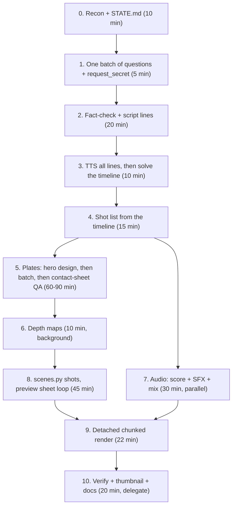

# Video Production Playbook for Agents

**Written by the agent that made _"Abandoned, But Not Forgotten"_** (a 90-second, 1080p24 animated NASA trailer). The video was finished and approved, but the work took about 16 hours of wall-clock time for what should take about 4. This document covers what worked, what wasted time, and the order to do things in next time.

> [!IMPORTANT]
> **Do not start from zero — and do not overwrite the Surveyor 3 project.**
> - **Finished Project 1 (*"Abandoned, But Not Forgotten"* — Surveyor 3 & Opportunity Trailer):** Lives in `/home/mohammed/.t3/projects/nasa/production/` and `/home/mohammed/.t3/projects/nasa/deliverables/`. Treat its `plates/`, `audio/`, `build/`, `reference/`, and `deliverables/` as a **read-only finished archive** so you never mix its files with a new video.
> - **Shared Runtime Assets (Reuse in place — do NOT re-download):**
>   - Python environment: `/home/mohammed/.t3/projects/nasa/production/.venv/bin/python`
>   - Models (`kokoro-v1.0.onnx`, `voices-v1.0.bin`, `depth_small.onnx`): `/home/mohammed/.t3/projects/nasa/production/models/`
>   - Fonts (`Montserrat.ttf`, `CormorantGaramond.ttf`): `/home/mohammed/.t3/projects/nasa/production/fonts/`
>   - Planetary textures (`moon_2k.tif`, `mars_2k.jpg`, `earth_2k.jpg`): `/home/mohammed/.t3/projects/nasa/production/textures/`
> - **Where to create a new video:** Create a fresh directory `/home/mohammed/.t3/projects/nasa/projects/<project_slug>/production/` and `/home/mohammed/.t3/projects/nasa/projects/<project_slug>/deliverables/`, symlink `models`, `fonts`, and `textures` from `/home/mohammed/.t3/projects/nasa/production/`, copy `src/*.py`, and replace only `script_lines.py`, `plates_batch.py`, `scenes.py`, and the chord/SFX tables in `audio.py`.

---

## 0. TL;DR: the 12 rules

1. **Write `STATE.md` in the project in the first 5 minutes, and update it after every milestone.** Sessions *will* die from quota limits and context handoffs. In this project, recovering context after handoffs cost more time than any single technical problem.
2. **Ask every blocking question in one batch at the very start**, then save the answers to `STATE.md`. Typical questions: duration conflicts, animation approach, and API tokens (through `request_secret`).
3. **Budget image generation before writing any code.** The built-in `generate_image` tool gave **about 3 images per account per ~5 hours**. Count your plates, rank them, and get tokens or accounts ready up front.
4. **Base historical and technical subjects on real reference photos**, and restyle them with image editing. Pure text-to-image got the hardware wrong again and again.
5. **Make a contact sheet after every image batch** and check it against an accuracy checklist before anything goes into the pipeline.
6. **Build the timeline from the dialogue.** Generate the TTS first, measure the line lengths, solve the timing, *then* design the shots.
7. **Preview 24 stills (about 1.5 min) before every full render (about 22 min).** The previews caught a crash and a clipped title.
8. **Launch long renders detached** (`setsid nohup … &`) and split them into resumable chunks. Background tasks tied to the chat get killed when the user sends a message.
9. **Use absolute paths and `.venv/bin/python` everywhere.** Never `cd` inside a backgrounded subshell.
10. **Never grep the whole project.** `.venv`, `models` and `build` together are more than 1.5 GB.
11. **The thumbnail is a deliverable.** I forgot it and the user had to ask.
12. **Delegate the boring parts** (waiting on renders, verification, writing reports) to a cheaper model or another account from the start.

---

## 1. What actually happened (timeline of mistakes)

| # | What I did | What went wrong | Cost | What to do instead |
|---|---|---|---|---|
| 1 | Generated the hero design with text-to-image | The lander had **4 legs** (the real Surveyor 3 has 3) | 2 images of a 3-image quota | Start from a real NASA photo or diagram and restyle it ("keep composition, hardware, proportions"). Count the structural parts in every output. |
| 2 | Asked the image editor to "fix the legs" using the bad image as reference | It **returned the reference unchanged** | 1 image | If an edit doesn't work, regenerate from the *original real reference* with a different angle. Don't iterate on a broken output. |
| 3 | Assumed image generation was unlimited | Quota ran out after **3 images**, with a 5-hour reset. That happened on several accounts. | Hours of blocking | Check the quota with one test image at the start. Plan for about 17 plates and a fallback source. |
| 4 | Tried Pollinations.ai as a free fallback | Unusable quality and watermarks | 3 min | Skip it. |
| 5 | Used Hugging Face FLUX spaces anonymously | ZeroGPU anonymous limit was **1–2 images** | 1 failed batch | Ask for a **free HF read token via `request_secret` at the start**. FLUX.1-Kontext then took ~35 s/image. |
| 6 | Passed the token as `Client(..., hf_token=…)` | `gradio_client` 2.x uses `token=` | 1 failed batch | Check `inspect.signature(Client.__init__)` before running a batch. |
| 7 | Accepted FLUX outputs without review | Orange, Mars-like Moon; swirly Moon texture; Atlas rocket with fins it never had; a "JPG" that was actually **WebP** | Had to regenerate 3 plates later | Contact sheet plus checklist after each batch. Normalize every image with PIL on ingest (`Image.open().convert('RGB').save(.jpg)`). |
| 8 | Generated an Apollo 12 plate | It showed **rover tyre tracks**, but Apollo 12 had no rover | 1 regenerate | Put anachronisms in the checklist: tracks, logos, extra crew, wrong era of hardware. |
| 9 | Delegated image generation to other accounts | Child tasks failed with **"Verify your account to continue"** | 3 delegation attempts | Before relying on other accounts, ask the user to open one chat on each account so verification is done. |
| 10 | Swapped two plates, but didn't redo their depth maps | The renderer used **stale depth maps** | Caught by chance | Make the pipeline mtime-aware: regenerate a depth map if `plate.jpg` is newer than `depth.npy`. |
| 11 | Ran `cd models && curl … &` chains in a backgrounded subshell | Files landed in the **wrong directories**, the venv wasn't active, and the fonts zip was lost | 10 min | Use absolute output paths (`curl -o /abs/path`) and call `.venv/bin/python` directly. |
| 12 | Kicked off the full render as a normal background task | The user typed a message, which **cancelled the render**. This happened twice. | ~30 min of lost frames | Use `setsid nohup env WORKERS=4 .venv/bin/python src/render.py > log 2>&1 < /dev/null & disown`, with resumable 2-second chunks. |
| 13 | Ran a preview with an untested shot function | A numpy broadcast crash in one shot | 1 min (the preview caught it) | Always run the preview sheet first. It's cheap. |
| 14 | Set the title at 86 px with wide tracking | The title was **wider than 1920 px** and clipped on both edges | 1 min (the preview caught it) | Measure rendered text width in code and assert it is under 85% of W. |
| 15 | White labels over sunlit grey ground | Hard to read | 1 re-render of the affected chunks | Put a soft dark scrim behind every lower-third label (see `fx.label`). |
| 16 | `grep -r` over the project, twice | Hung on `.venv` and `models` | 2 killed tasks | Grep `src/` only, or use `--exclude-dir`. |
| 17 | Forgot the thumbnail | The user had to ask for it | One more round trip | Thumbnail goes in the deliverables checklist. Put the title on open space, not over the subject (my first try overlapped the lander). |
| 18 | Did everything myself on the top model | Burned through the user's premium quota | The user had to intervene | Delegate render-watching, verification, and report-writing to a cheaper model from day one. |
| 19 | The user pasted an API token in chat | The secret ended up in the chat transcript | Security risk | Call `request_secret` **before** you need the token, with `delivery: "file"`. |

---

## 2. Environment facts (check them; don't assume)

What this machine had: **4 CPU cores, 7 GB RAM, no GPU, no Blender**, ffmpeg with libx264/aac, `uv`, and network access to PyPI, Hugging Face and GitHub. The NASA image API works; `images-assets.nasa.gov` returns 403 on HEAD requests but GET works.

Run this first, in one command:

```bash
nproc; free -g; nvidia-smi 2>&1 | head -3; which ffmpeg blender uv; \
ffmpeg -hide_banner -encoders 2>/dev/null | grep -E "libx264|aac"; \
curl -sI https://huggingface.co | head -1; df -h . | tail -1
```

Set up the venv (about 3 min):

```bash
uv venv -q .venv --python 3.12
uv pip install -q --python .venv/bin/python numpy pillow scipy soundfile onnxruntime kokoro-onnx \
    opencv-python-headless gradio_client
```

Models (about 430 MB, download in parallel with **absolute paths**):

| Asset | URL | Use |
|---|---|---|
| Kokoro-82M ONNX + voices | `github.com/thewh1teagle/kokoro-onnx/releases/download/model-files-v1.0/{kokoro-v1.0.onnx,voices-v1.0.bin}` | Local TTS on CPU (Apache-2.0). Voice `af_heart` = warm female narrator. |
| Depth-Anything-V2-small | `huggingface.co/onnx-community/depth-anything-v2-small/resolve/main/onnx/model.onnx` | Depth maps for 2.5D parallax (~5–20 s per plate on CPU) |
| Moon texture | `svs.gsfc.nasa.gov/vis/a000000/a004700/a004720/lroc_color_poles_2k.tif` | NASA LRO colour map for the procedural Moon sphere |
| Mars/Earth textures | solarsystemscope.com 2k textures | Procedural planets |
| Fonts | Montserrat (UI/labels), Cormorant Garamond (title) | Google Fonts, OFL |

---

## 3. The approach that worked: hybrid 2.5D

There was no text-to-video model, no GPU and no Blender. The method that produced a "feature-film" look was:

1. **AI-generated 16:9 stills ("plates")**, one per shot, all derived from one approved hero design so the character stays consistent.
2. **A depth map per plate.** The renderer moves a virtual camera with *real parallax*: depth-dependent dolly, pan and orbit, plus rack focus driven by depth. This looks much more like 3D than a Ken Burns zoom.
3. **Local mechanical motion** through small radial warps on parts (camera head turning, scoop digging, rover arm reaching), sometimes crossfaded with a second plate of the end pose.
4. **Procedural overlays**: 3D starfield, ray-cast textured planets, depth-layered dust motes, glows, transmission rings, and an oscilloscope trace of the real voice signal.
5. **Finishing**: per-scene colour grades, bloom, filmic highlight roll-off, grain, vignette, and a **2.2:1 letterbox**. The letterbox hides AI-plate edge artifacts *and* gives subtitles a home that never covers the picture.

Rejected alternatives and why:

- **three.js/procedural 3D**: real motion, but next to AI plates the style clashes badly.
- **Plain Ken Burns**: the brief explicitly bans slideshows.
- **"Package for an external video AI"**: the user wanted a finished MP4.

The user still has to choose between these up front (see the questions in §4).

---

## 4. The efficient order of work

Times are realistic estimates for a 90-second film on this machine.



### Step 0: Recon and STATE.md
- Read the brief, *all of it*, including long prompts beyond the first 4,000 characters. Long briefs get truncated in tool output, so page through them with `textOffset`.
- Check for attachments. The brief said "reference images provided", but the attachments folder was **empty**. Say so and source public-domain references yourself (NASA Image API: `https://images-api.nasa.gov/search?q=…&media_type=image`).
- Create `STATE.md` with: goal, user decisions, the plate list with status, the pipeline status, and the next action.

### Step 1: Ask once
Typical blockers to put in **one** `ask_question` call:
- **Contradictions in the brief.** This one said "~40 s" in the header and "90 s" in the body, with full 90-second scene timings.
- **The animation approach** (hybrid 2.5D, true 3D, or package for an external tool).
- **Secrets.** Call `request_secret` for an HF token right away, with `delivery: "file"`. Store it at `~/.cache/huggingface/token`, mode 600, never in the repo.
- **Accounts.** If the user has several accounts, ask them to confirm each one is verified.

Then **write the answers into `STATE.md`.** After a handoff I could not see the user's answers and had to dig through history to find them.

### Step 2: Fact-check and script
- Verify every date and number against primary sources (NASA NSSDCA, science.nasa.gov). The brief's own figures may be wrong or disputed:
  - "Two years later" was really 2.5 years (Apr 1967 → Nov 1969). I fixed it in the script.
  - "6,315 images": sources disagree (6,315 vs 6,326). I kept the brief's number and **flagged it in the report**.
- `script_lines.py` keeps two versions of each line: a **TTS spelling** ("nineteen sixty-seven", "Surveyor Three") and a **subtitle spelling** ("1967", "Surveyor 3"), with `|` to split long subtitles.

### Step 3: Timeline from the dialogue
- TTS **each line separately** (`tts.py`), trim the silence, and record durations to `durations.json`.
- Use slower speed for emotional lines (×0.94) and faster for dense informational lines (×1.12).
- `timeline.py` takes the per-line pre-gaps and solves one **gap-scale** factor so the last line ends right before the target duration with a musical tail. Scene starts are derived as "first line of the scene minus a lead-in".
- The brief's per-scene time windows did not fit natural speech. Let narration flow across cuts instead of forcing hard windows.
- You cannot listen to audio. Pick voices by their known quality grades (Kokoro `af_heart` = A) and judge the pacing from the durations.

### Step 4: Shot list
- About 23 shots for 90 s: one shot per 3–5 s, with each shot anchored to a line start (`T["s5_04"] - 0.25`).
- Every shot needs motion: a dolly-in, a parallax orbit, rack focus, or a mechanical warp. Use shake only for launch and touchdown.
- Include at least one non-plate motion-graphics shot (here, an image mosaic with a counting number) and one POV shot. They break up the rhythm.

### Step 5: Plates (where most time is lost)
Image sources, in order of preference:
1. **The built-in `generate_image`.** Best quality and accuracy, but **~3 images per account per ~5 h**. Use it for the hero design and the hardest shots.
2. **FLUX.1-Kontext-Dev on HF Spaces** with a free token (~35 s/image, decent consistency when edited from a reference). Wrapper: `src/flux.py`; batch definitions: `src/plates_batch.py`.
3. **FLUX.1-schnell.** Fast, but weak on technical accuracy (it gave the rocket fins it never had).
4. **Real public-domain NASA photos, restyled.** Most accurate for history: astronauts, launch pads, rovers.

Workflow:
1. **Make the hero design sheet first** from a real reference. Get it right (count legs, antennas, wheels), then use it as the reference image for every other plate of that character.
2. Write each prompt as: **KEEP block** (the exact hardware description: "exactly three legs with round footpads, …; no face, no eyes, no wheels") + scene + **STYLE block** ("premium 3D animated feature-film still, PBR, cinematic light, no text, no logos, no watermark").
3. For real-photo restyles: "Convert this real NASA photograph into a full-colour 3D animated film still. **Keep the exact composition, camera angle, hardware shapes and poses.**" Pre-crop or pad the input to 16:9 first.
4. Generate in priority order (emotional centrepiece first) so that if the quota dies, the important shots exist.
5. After each batch, run the **contact sheet + checklist**:
   - [ ] Part counts correct (legs, wheels, panels, antennas)
   - [ ] No faces or eyes on machines (unless the brief allows it), no invented parts
   - [ ] No anachronisms (rover tracks on Apollo 12, modern logos, wrong rocket shape)
   - [ ] Correct world colours (grey Moon, butterscotch Mars sky, black lunar sky)
   - [ ] No text, watermarks or fake NASA logos
   - [ ] Consistent with the hero design
6. Move rejects to `scratch/rejected/` with a reason in the filename. Never delete them.

### Step 6: Depth
`src/depth.py` runs Depth-Anything-V2-small on every plate. Rerun it for any plate you replace.

### Step 7: Audio (run in parallel with steps 5–8)
`src/audio.py` synthesizes everything with numpy/scipy: no samples and no copyright risk.
- **Instruments**: inharmonic additive piano, detuned-saw string ensembles, horns with a filter-envelope crossfade, timpani, celesta, plucks.
- **SFX**: radio static with crackle, pings, servo whirs with gear grit, rocket rumble from brown noise, thuds, whooshes and risers from STFT band-sweeps.
- **Mix**: per-stem RMS calibration (voice −19, music −25.5, SFX −29, ambience −38 dBFS), sidechain ducking of the music under the voice (up to −6 dB), convolution reverb with synthetic IRs, a soft-clip bus, then **two-pass `loudnorm` to −16 LUFS / −1.5 dBTP**.
- **Writing music per scene**: give each scene a chord progression locked to the solved timeline (`SC[3] + 12.95` for touchdown). Hit the visual events with impacts, timpani and rolls.
- Since you can't listen, **print an RMS-over-time table** of voice, music, SFX and mix, and check that the voice always sits clearly above the music.

### Step 8: Shots and the preview loop
- `python src/scenes.py 1.6 5.0 8.5 …` renders 24 stills into `scratch/preview.jpg` in about 1.5 min. **View it. Fix. Repeat.** Never start a full render without a clean preview.
- Check: text clipping, label legibility, seams at cross-dissolves, black frames, subtitle timing, and the "DRAMATIZED RECONSTRUCTION" tag on recreated history.

### Step 9: Render
- `render.py` renders 45 chunks of 48 frames, each piped straight into `libx264 -crf 16 -preset slow` (no PNGs on disk). It uses 4 workers with `OMP_NUM_THREADS=1` and `cv2.setNumThreads(1)`, stream-copies the chunks together, and muxes the loudness-normalised audio with `-t 90.000`.
- Speed: **~2.3 s/frame per worker, which works out to ~22 minutes for 2,160 frames.**
- To change a few shots, re-render only the affected chunks (`python src/render.py 40 41 42`; chunk *i* covers [2i, 2i+2) s), then `--assemble`. Audio-only changes take seconds: `python src/render.py --assemble`.
- **Launch it detached.** See rule 8.

### Step 10: Verify and deliver
- `ffprobe`: duration exactly 90.000 s, 2,160 frames, 1920×1080, yuv420p, AAC 48 kHz. Measure loudness. Run a black-frame check (`blackdetect`).
- Make a 24-frame contact sheet of the *final MP4* (not the preview).
- **Thumbnail**: 1920×1080 PNG and 1280×720 JPG, with the title on open space. Embed it as `attached_pic`.
- Docs: script with timestamps, a production report that separates real archival material from reconstructions and lists every fact with its source, and an editable-project guide.
- This whole step is a good candidate for a cheaper delegate.

---

## 5. Working around sessions, quotas and interruptions

This was the biggest time sink of the project. The session hit the usage quota **6 times**, the user interrupted it several times, and there were about 8 context handoffs.

- **`STATE.md` is your memory.** Re-reading 400+ thread items after every handoff cost a lot of tokens and time. A 50-line state file would have replaced all of it.
- **Every long job must survive your death:** detached processes, resumable outputs, and logs written to files. Then the next session only needs `pgrep -af render.py; ls build/chunks | wc -l; tail log`.
- **Finish small, verifiable units.** "All 31 voice lines exist" is worth more than "half of scenes.py is written".
- **Don't poll.** Start the job, do other work (docs, audio, QA), and let the completion notification wake you.
- **When the user says "why did you stop?"**, the honest answer is usually quota or a cancelled background task. Say which one, then change the setup so it can't happen again (detach the job).

---

## 6. Delegation strategy

The user explicitly wanted premium-model usage saved for hard work.

| Hard: do it yourself | Easy: delegate to a cheaper model or another account |
|---|---|
| Creative direction, shot design, `scenes.py` | Downloading models, textures, fonts and references |
| Hero design approval and plate QA | Generating already-specified plates from `plates_batch.py` |
| Score composition and the mix-balance logic | Waiting on renders, restarting dead renders, assembly |
| Fact-check judgment calls | `ffprobe` verification, contact sheets, black-frame checks |
| Final review of the contact sheet | Writing the script, report and guide from existing data; making thumbnails |

Each delegate brief must be **self-contained**: absolute paths, exact commands, which files it must **not** edit (the creative code), and what to report back. Delegates on unverified accounts fail immediately with "Verify your account to continue".

---

## 7. Reusable toolkit map (`production/src/`)

| File | What it does | What to change for a new video |
|---|---|---|
| `script_lines.py` | All lines: `(id, scene, _, tts_text, subtitle_text)` | **Everything** |
| `tts.py` | Kokoro TTS per line, trimming and durations (`python src/tts.py s2_03` regenerates one line) | Voice, per-line speed lists |
| `timeline.py` | Solves the gap scale to hit `DURATION`; outputs `T`, `E`, `SCENES` | `DURATION`, pre-gaps, scene lead-ins |
| `flux.py`, `plates_batch.py` | Free FLUX Kontext/schnell wrapper and batch prompts | KEEP/STYLE blocks, jobs |
| `depth.py` | Depth maps for all plates | Nothing |
| `fx.py` | Engine: `Plate.render` (parallax camera, dolly, DOF, local warps), `sphere`, `Starfield`, `Dust`, glows, rings, `tv_look`, text, labels with scrim, grades, `finish` | Grades, fonts |
| `scenes.py` | Shot functions, the `SHOTS` table with crossfades, `LABELS`, subtitles, `render_frame(t)`, and the preview CLI | **Shots and labels** |
| `audio.py` | Procedural score, SFX, ambience, voice FX, reverb, ducking, stems, premaster | Per-scene chord charts and SFX cues |
| `render.py` | Parallel chunked x264 render, concat, two-pass loudnorm, mux | Nothing (`WORKERS` env var) |
| `thumbnail.py` | Thumbnail from a plate, with the title in the film's fonts | Plate, title layout |

---

## 8. Brief-compliance checklist (copy into STATE.md)

- [ ] Duration exactly as agreed; consistent fps; 1080p H.264 + AAC; faststart
- [ ] First 5 seconds are a real hook (sound and image from the very first frame)
- [ ] Character design is consistent in every shot and matches the real hardware
- [ ] Every shot moves; no slideshow
- [ ] Dialogue always intelligible (check the RMS table); music ducked
- [ ] Subtitles in the letterbox, never covering important detail
- [ ] Labels requested by the brief appear, spelled exactly
- [ ] Dramatized reconstructions are tagged; real archival material is credited
- [ ] No invented dialogue for real people, no fake logos, no unverified claims
- [ ] Facts verified against primary sources; disagreements flagged in the report
- [ ] No black gaps, repeated frames, placeholder text or watermarks
- [ ] Deliverables: MP4, editable project, all assets, timestamped script, provenance report, **thumbnail**
- [ ] Be honest in the final message about what is AI-generated, procedural, or archival, and what could not be done
